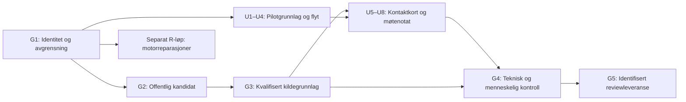

# NAVigator – gjennomføringsplan

> **For agentic workers:** Bruk `superpowers:executing-plans` til å utføre avgrensede oppgaver sekvensielt. Planen bruker avkrysningsbokser for fremdrift. Ingen underagenter er nødvendig som utgangspunkt.

**Goal:** Levere et kontrollert referansegrunnlag og én privat pilot som hjelper brukeren fra et konkret behov til en forståelig første kontakt og et nyttig møtenotat.

**Architecture:** Tre separate løp: offentlig referanseutgave, statisk privat pilot og eksperimentell runtime. Piloten bygger videre på husholdningsvariantens logikk og den rolige variantens presentasjon. Runtime holdes frakoblet til dens egne korrekthetsgrenser er dokumentert.

**Tech Stack:** Markdown/JSON, Python, eksisterende HTML/CSS/JavaScript, lokal Node/AJV-validering og nettleserkontroller. Ingen ny frontendplattform eller ekstern datatjeneste inngår.

**Spec:** [Analysen 08.10.2026](/Users/reidar/Projectos/NAVigator/PRODUCT_REVIEW_2026-10-08.md), [mål C](/Users/reidar/Projectos/NAVigator/docs/maal-og-avgrensning.md), [UI- og UX-planen](/Users/reidar/Projectos/NAVigator/docs/superpowers/plans/2026-10-08-navigator-ui-plan.md).

**Status:** Planlagt, ikke implementert eller faglig godkjent. Opprettet etter brukerens eksplisitte bestilling av en omfattende arbeidsplan. Anbefalingene nedenfor er planbeslutninger som kan justeres før gjennomføring; de er ikke nye utgivelsesgodkjenninger.

## Global Constraints

- Mål C er først en «versjonert, avgrenset norsk referansebase». Familier, barn/unge og tilknyttede helse-, skole- og økonomiinnganger er den dokumenterte kjernen; det avgrensede kommuneutvalget utvides ikke her.
- Den private bolig-/økonomipiloten er et separat brukerproduktspor. Den skal ikke hevde å dekke hele referansebasen.
- Bevar `UTKAST`, `distribution_gate=BLOCKED`, frosne evalueringer, låser, regler, registre, manifest og historiske pakker. Nye versjoner lages ved siden av originalene.
- Privat/case-avledet materiale skal ikke inn i generelle sammendrag, offentlige artefakter eller modellprompter. Personvernarbeid bruker metadata og lokale, avgrensede verktøy; en faglig/personvernkontroll gjøres på den faktiske kandidaten.
- «Vet ikke», «Vil ikke oppgi», ubesvart og eldre kombinert ukjent-svar skal ikke bli nei eller avslag.
- Hashkontroll, kildefaglig kontroll, programfunksjon, brukerforståelse og faktisk drift får separate resultater.
- Arbeid i isolert arbeidskopi. Git-worktree kopierer ikke ignorerte pilotpakker; tillatte pilotinnganger må håndteres eksplisitt.
- Ingen automatisk lagring av sensitive svar, runtime-tilkobling, offentlig tilgjengeliggjøring eller produksjonsdeploy inngår i pilotforbedringen.
- Før lengre bygg-/testarbeid: kontroller minst 30 GiB ledig disk. Bruk avgrensede arbeids- og outputkataloger.

## Review Focus

1. Brukeren oppgir bare to behov, uten fritekst eller ordningsnavn: en nyttig, begrenset kontaktflyt skal være tilgjengelig. Eier: UI-oppgave U2–U4.
2. Privat informasjon er avledet eller finnes bak en kryssreferanse: hele den avledede kandidaten må kontrolleres, ikke bare navn/filklasse. Eier: G2.
3. Kilden er riktig identifisert, men feil for tidspunkt, målgruppe eller kontaktvei: den berørte handlingen begrenses. Eier: G3 og runtime R3–R4.
4. Brukeren endrer svar etter kontakt/lagring: råd, fremdrift og eksporter må vise riktig grunnlag uten å miste historikken. Eier: U2, U7–U8.
5. En teknisk feil eller manglende kilde blir tolket som «ingen hjelp finnes»: feilen skal vises ærlig og med et forsvarlig neste steg. Eier: G4, U4–U6 og R3–R6.

## Leveranser og avhengigheter

| Løp | Leveranse | Avhengighet | Utgivelsesgrense |
|---|---|---|---|
| G – grunnlag | Kandidatspesifikk offentlig referanseutgave, påstands-/kildegrunnlag og vedlikeholdsregler | G1–G3 | Faglig/personvernkontroll på kandidat før generell utgivelse |
| U – privat pilot | Sammenhengende behovs-, kontakt- og ta-med-flyt | G1; faglig vurdert handlingstekst fra G3 | Kan vurderes lokalt med syntetiske data mens distribusjon er BLOCKED |
| R – runtime | Isolerte reparasjoner av personvern, sikkerhet, evidens og discovery-status | Egne syntetiske tester og eksplisitt senere aktiveringsmål | Ingen tilkobling bare fordi tekniske tester består |

## Filstruktur og kildevalg

Planlagte stier er relative til en fremtidig isolert checkout av NAVigator. Dokumentene ligger i primærkopien; implementasjonen skal ikke gjøre de eksisterende ignorerte arkivene til arbeidskopi.

| Sti | Ansvar |
|---|---|
| `pilot/` | Foreslått kanonisk, kontrollert pilotkilde. Kopieres selektivt fra B; ingen privat sesjon, archive, node_modules eller ukontrollert korpus følger med. |
| `pilot/src/{template.html,styles.css,safety.js,state-plan.js,ui.js}` | Eksisterende type ansvarsdeling. UI-planen angir konkrete endringer. |
| `pilot/src/summary.js` | Ny felles projeksjon av brukerens valgte innhold til møtenotat/utskrift. |
| `pilot/build/`, `pilot/tests/`, `pilot/package.json`, `pilot/package-lock.json` | Kandidatens egen generator, kontraktkontroller og lokale utviklingsavhengigheter. Eksisterende versjonspinner bevares ved flytting. |
| `pilot/data/`, `pilot/kilder/`, `pilot/evidens/` | Bare eksplisitt tillatte innganger. Nye innholds-/UI-versjoner får egen identitet; gamle frosne innganger omskrives ikke. |
| `releases/next/` | Planlagt metadata for ny kandidat: profil, påstandsbeslutninger, manifest og leserveiledning. Bare materiale som tåler repoets synlighet. |
| `tools/reference_release.py`, `tests/test_reference_release.py` | Foreslått liten eksport-/kontrollrutine med syntetiske tester. |
| `runtime/` | Eget reparasjonsløp, beskrevet i [runtime-planen](/Users/reidar/Projectos/NAVigator/docs/superpowers/plans/2026-10-08-navigator-runtime-plan.md). |
| `outputs/<candidate-id>/` i arbeidskopien | Avgrenset lokal output og kvitteringer; tas ikke med i generell publisering uten innholdskontroll. |

Kilde B: `/Users/reidar/Projectos/NAVigator/NAVigator-pilot-privat-2026-09/NAVigator-household-income-2026-09-23/work`, HTML SHA `203136c9c513999abdb87f35b80fe010b600181cd6cd40a4aa58e2c36dc5cadd`.

Visuell referanse A: `/Users/reidar/Projectos/NAVigator-rolig-start-2026-09-23`, HTML SHA `9a1ce8d2144ccbcf91f9f5121fbf66c148c5af74df401202c72a3a0f2b74a4c5`.

Disse identitetene ble kontrollert under analysen. G1 skal kontrollere dem på nytt før kopiering; navn og dato alene avgjør ikke valg.

## G1 – Etabler én konkret utviklingskandidat

**Files:** Ny `pilot/` etter innholdskontroll; ny `releases/next/candidate.json`; oppdater `PILOT_LINEAGE.md` og `CURRENT_STATE.md` med referanse til den nye kandidaten ved utføring. Eksisterende pilotkilder/bygg beholdes.

**Interfaces:** `candidate.json` angir `candidate_id`, `base_git_sha`, `source_pilot_sha256`, `presentation_reference_sha256`, `allowed_inputs`, `content_version`, `distribution_gate`, `runtime_enabled=false`. Hashes beskriver kildeidentitet, ikke faglig kvalitet.

- [ ] Registrer fersk Git-/WIP-identitet, diskplass og de to manifestene. Sammenlign mot analysens kontrollgrunnlag; vurder eventuelle endringer før kopiering.
- [ ] Opprett/rebruk egnet isolert worktree med `codex/`-gren. Revider siste remote dokumentasjonskontrakt; primærkopiens WIP bevares.
- [ ] Velg B som logikkgrunnlag og A som presentasjonsreferanse. Lag positiv filallowlist; kontroller hvert faktisk nødvendig inngangsdokument før det flyttes til den nye kilden.
- [ ] Kopier bare tillatt kilde, utviklingskonfigurasjon og avklarte innganger. Manglende kildegrunnlag skal sperre et reelt bygg; syntetiske fixtures kan brukes til UI-utvikling imens.
- [ ] Registrer ny kandidat og gamle rollback-identiteter. Bekreft at generatoren bruker kandidatens egen rot, og at en Git-klone alene ikke utgir seg for å inneholde de ignorerte arkivene.

**Akseptanse:** Én identifisert utviklingskilde; ingen private eller ukontrollerte kopier; originalene byteidentiske; generator/test/output peker til samme kandidat. Eksisterende saker #3, #23–25.

## G2 – Bygg offentlig avledning med faktisk personvernkontroll

**Files:** Ny `releases/next/public-profile.json`; ny `tools/reference_release.py`; ny `tests/test_reference_release.py`; ny kandidatleserveiledning. Den nåværende `data/publiseringsprofil-v1.json` og rev2-pakken er grunnlag, ikke filer som automatisk oppdateres.

**Interfaces:**

- `build_candidate(source_root: Path, profile_path: Path, output_dir: Path) -> dict`: bruker bare positivt tillatte dokumenter/avgrensede seksjoner; produserer nytt manifest og sanitert kandidat.
- `check_candidate(candidate_root: Path) -> dict`: kontrollerer manifest, interne referanser, uavklarte tillatelser og metadata uten å lese det private arkivet som default.
- Profilen skiller `GENERAL_APPROVED`, `EXCLUDED_PRIVATE`, `EXCLUDED_DERIVED` og `UNREVIEWED`. Ukjent/manglende tillatelse avvises. Klassifikasjon fra dagens kunnskapsindeks brukes ikke alene som tillatelse.

- [ ] Skriv syntetiske negativtester: privat fil, avledet seksjon, privat kryssreferanse, sti utenfor rot, symlink, manglende tillatelse og endret kildehash skal avvises.
- [ ] Kjør `python3 -m unittest tests.test_reference_release` og bekreft de forventede feilene før implementasjon. Testmappen etableres med `__init__.py` i denne oppgaven hvis den ikke finnes.
- [ ] Implementer én liten eksport-/kontrollrutine. Seksjonsfjerning bruker godkjente selektorer og forventet kildehash; ingen generell automatisk «anonymisering» eller navn-erstatning som eneste vern.
- [ ] Lag ny avledet kandidat fra tillatte kilder. Privat innhold behandles bare lokalt i nødvendig avgrenset kontroll; råtekst og personidentifikatorer skal ikke bli modellinput eller logger.
- [ ] Kontroller den ferdige kandidaten og kryssreferansene. Før separat kontrollkvittering med kandidatens hash; ved nytt funn beholdes sperren og revisjonen får ny identitet.

**Akseptanse:** Ingen private/avledede opplysninger eller private lenker i generell kandidat; full referanseintegritet; kilde og avledning sporbare. Et tomt navn-søk alene er utilstrekkelig. Eksisterende #2, #6, #21 og #36.

## G3 – Samstem hver handlingsbærende påstand og kontakt

**Files:** Ny `releases/next/claim-decisions.json`; ny vedlikeholds-/leserveiledning; nye versjonerte pilotinnganger for eventuelle vedtatte rettinger. Rev2s kontrollregister med 26 påstander bevares som historisk kandidat.

**Interfaces:** Beslutning per påstand har `claim_id`, kandidat-/kildehash, anvendelsesområde, kildedato, kontrollert_dato, kontrollør, `KEEP|LIMIT|OMIT|PENDING`, begrunnelse og nykontrollregel. Ingen status arves mellom kandidater uten eksplisitt binding.

- [ ] Lag en kontrollmatrise for eksisterende 26 påstander og pilotens første-kontakt-/hastformuleringer. Skill kjent tjeneste, relevant kontaktinngang, kontrollert tilgang og rett til ytelse.
- [ ] Forbered konsise kildepakker fra autoritative kilder for nødvendige presiseringer: mat straks, usikkert midlertidig opphold, kontaktbetegnelser, åpningstider og alternativ når stengt. Nye oppslag holdes utenfor frosne målegrunnlag.
- [ ] La kvalifisert kontrollør avgjøre handlingsbærende retts-/helse-/sikkerhetspåstander på eksakt kandidat. Jeg kan forberede evidens og implementere besluttet ordlyd; faglig godkjenning utføres av kontrolløren.
- [ ] Implementer bare besluttede rettinger i ny innholdsversjon. Uavklart lokal kontaktvei vises som uavklart; ingen oppdiktet akutttelefon eller garanti om behandlingstid.
- [ ] Kontroller at UI, møtenotat og referanseleser bruker samme beslutning og dato. Endret kilde gjør berørte råd kontrollpliktige, uten å erklære alle andre kilder utdaterte.

**Akseptanse:** Alle viste handlingsbærende påstander er beholdt, begrenset eller utelatt med eksplisitt beslutning. PENDING løftes ikke til verifisert. Eksisterende #5–6, #12, #32, #57–59 og #64.

## G4 – Kvalifiser brukerproduktet på riktig nivå

**Files:** Ny `outputs/<candidate-id>/verification.json`, avgrenset testprotokoll og brukerprøverapport. Pilotens tester beskrives i UI-planen.

**Interfaces:** Kvitteringen har separate felt for `source_integrity`, `privacy_review`, `technical_checks`, `accessibility_review`, `user_trials`, `domain_review`, `deployment_readback`. Hvert felt er PASS/FAIL/NOT_RUN med evidensreferanse; intet sammenslått «alt godkjent».

- [ ] Kjør relevante syntetiske testsuiter etter U-oppgavene, med nettverk/provider avkoblet. Inspiser eksisterende tester før bred kjøring; tester som åpner privat indeks eller kjører live discovery skal ikke starte som standard.
- [ ] Kontroller den genererte HTML-en i valgt nettleser: hovedvei, begrenset vei, sikkerhetsvei, svarendring, kontakt, eksport/import og utskrift. Lagre skjermbilder med eksakt byggidentitet.
- [ ] Gjør manuell mobil-/tastatur-/VoiceOver-/zoomkontroll. Kontroller faktisk opplesing og fokus, ikke bare at ARIA-attributter finnes.
- [ ] Gjennomfør 5–8 modererte oppgaveprøver med fiktive scenarioer og variert behov for enkelt språk/hjelpemidler. Jeg forbereder oppgaver og analyse; mennesker utfører prøvene.
- [ ] Rett kritiske feil fra prøvene og kontroller den berørte flyten igjen. Unngå ubegrenset retesting av uendrede områder.

**Akseptanse:** Brukere kan forklare første kontakt og usikkerhet, finne kontaktmåten og lage et nyttig notat uten moderatorhjelp. Kritiske misforståelser fører til retting. Små utvalg brukes til feilfunn, ikke befolkningsprosent eller klinisk konklusjon.

## G5 – Pakk en konkret reviewleveranse og vedlikeholdsplan

**Files:** Nytt kandidatmanifest, kilde-/endringsoversikt, reviewveiledning og avgrenset pakke. Dokumentasjon oppdateres med faktisk resultat, ikke planlagt suksess.

- [ ] Bygg med fast `--generated-at` i isolert kandidat og separat outputrot. To identiske innganger/tidspunkter skal gi identiske outputbytes; det gamle bygget omskrives ikke.
- [ ] Kontroller alle pakkemedlemmer, relative stier, referanser og hashes. Utelat node_modules, cache, personlige filer, sesjoner og utviklingslogger. En utviklingsrot er ikke automatisk en ren reviewpakke.
- [ ] Før gjenstående risiko, ansvar for kildevedlikehold, nykontrolldatoer og tilbakekallingsregel for feil råd.
- [ ] Knytt ferdig lokalt arbeid til eksisterende saker i en dispositionstabell. Foreslå sakstilstand ut fra evidens; GitHub-saker lukkes ikke som del av denne planbestillingen.
- [ ] Lever kandidaten for separat beslutning om privat utprøving/utgivelse. Behold BLOCKED der relevant faglig/personvern-/distribusjonskontroll mangler. Logg konkret resultat i Obsidian.

**Akseptanse:** En annen kontrollør kan rekonstruere kildegrunnlag, bygge kandidat, kontrollere den og se nøyaktig hva som fortsatt er uavklart. Deploy eller offentlig distribusjon er en senere handling med egen faktisk autorisasjon.

## Arbeidsrekkefølgen jeg vil følge

1. G1: sikre kildevalg, arbeidskopi og kontrollgrenser.
2. U1–U4: flytte tillatt pilotkilde, gjøre tilstanden entydig og reparere den sammenhengende hovedveien.
3. G2–G3: offentlig avledning og beslutnings-/kontaktgrunnlag. Disse kan forberedes parallelt med UI i foreldreagenten; kvalifisert kontroll kan være den eksterne ventetiden.
4. U5–U8: praktiske kontaktkort, mobil, eksport/import og møtenotat.
5. G4–G5: identifisert brukerprøving, feilretting og reviewpakke.
6. R1–R7: eget senere motorløp hvis runtime skal være del av neste produkt. Det er ikke på den private pilotens kritiske vei.

Hver oppgave avsluttes med avgrenset diff, relevant kontrollkvittering og oppdatert fremdrift. Ved en senere implementeringsbestilling anbefaler jeg sekvensielt arbeid i foreldreagenten; det er flere delte kontrakter og ingen grunn til å bruke bred modellfan-out. Ingen kalenderfrist kan forsvarlig gis før G1 og tilgjengeligheten til faglig kontrollør er avklart.

## Planens egen kontroll

- [x] Alle åtte arbeidspakker fra analysen er dekket av G-, U- eller R-oppgaver.
- [x] UI og runtime har egne konkrete planer og forskjellige aktiveringsgrenser.
- [x] Kildevalg og foreslåtte nye stier er skilt fra eksisterende implementasjon.
- [x] Personvern, ukjente svar, kildeendringer, endret plan og teknisk feil har navngitt oppgaveeier.
- [x] Faglig kontroll, brukerprøver og drift er skilt fra arbeid jeg kan automatisere.
- [x] Planleggingen gjør ingen produktkode-, manifest-, låse- eller deployendring.
