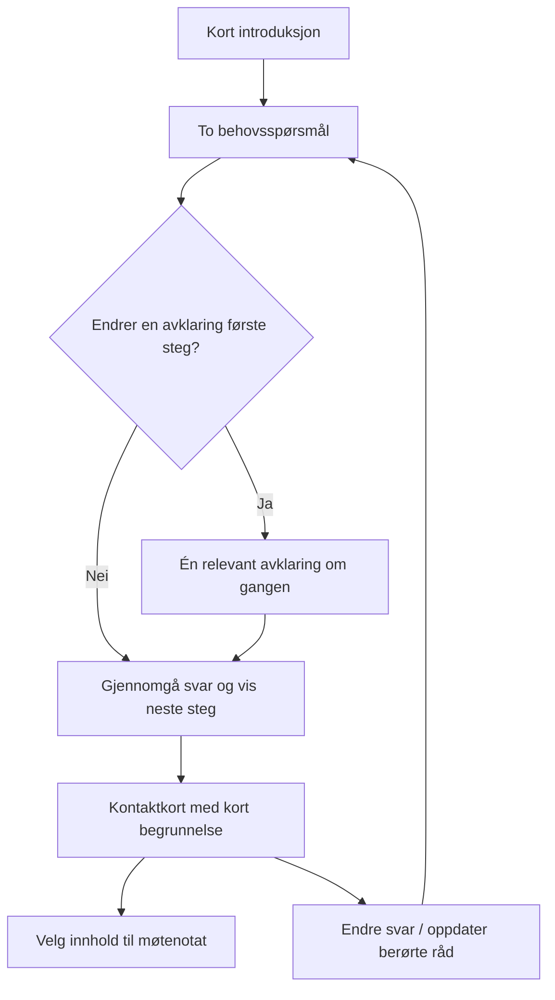

# NAVigator – UI- og UX-plan

> **For agentic workers:** Bruk `superpowers:executing-plans` og gjennomfør U1–U8 sekvensielt. Bruk avkrysningsboksene til å registrere faktiske resultater. Ingen bred ombygging eller underagentbruk er nødvendig.

**Goal:** Gjøre piloten rolig, lett å forstå og praktisk nyttig fra to enkle behovsspørsmål til første kontakt og et kort møtenotat.

**Architecture:** Bevar statisk HTML og dagens moduldeling. Gjør plantilstanden eksplisitt og uavhengig av DOM; la alle resultatvisninger bruke samme modell. Bruk én felles projeksjon for brukerens valgte eksportinnhold.

**Tech Stack:** Eksisterende HTML/CSS/JavaScript, Python-generator, Node/AJV og avgrensede nettleserkontroller. Ingen React-migrering, backend, ny konto eller automatisk datalagring.

**Spec:** [Analysen](/Users/reidar/Projectos/NAVigator/PRODUCT_REVIEW_2026-10-08.md). Avsnittene «Designbrief», «Visningene» og «Tilstander og kontrakter» nedenfor er den konkrete foreslåtte UI-spesifikasjonen. [Hovedplanen](/Users/reidar/Projectos/NAVigator/docs/superpowers/plans/2026-10-08-navigator-product-plan.md) bestemmer kilde-/faglige grenser.

**Status:** Plan/designforslag. Det er ikke bygget et nytt grensesnitt i denne etappen.

## Global Constraints

- Bruk B/husholdning som logikkgrunnlag og A/rolig start som presentasjonsreferanse etter G1s identitets-/innholdskontroll.
- Endre kildene og generatoren; ikke rediger generert HTML direkte.
- `UTKAST` og `distribution_gate=BLOCKED` beholdes. Tekniske detaljer kan flyttes til utdyping; produktets reelle begrensninger skal være synlige.
- Hjelp/kontakt ved faresignaler må ikke skjules bak samtykke, temavalg eller ubesvarte behovsspørsmål. Ordinære råd følger fortsatt vurderingsgrensene.
- Fritekst er valgfritt. Tom tekst er ikke en positiv sikkerhetsvurdering. En begrenset kontaktvisning er en egen tilstand, ikke en omgåelse av en akutt-sperre.
- Bevar særskilt ubesvart, ukjent, tilbakeholdt og eldre kombinert svar; ingen automatisk entitlement-/avslagsberegning.
- Ny spørsmålsemantikk, handlingsprioritet og sikkerhetstekst må ha kandidatspesifikk kilde-/faglig kontroll. Frosne policyfiler omskrives ikke.
- Ingen automatisk lagring, personidentifikatorer, tracking eller runtime-kobling i dette løpet.

## Review Focus

1. To svar og ingen fritekst: begrenset kontaktvei uten «situasjonen er trygg». U2/U4.
2. Ukjent eller tilbakeholdt svar importert fra eldre format: betydning og brukerens valg bevares. U3/U8.
3. Kontakt kortet blir utdatert etter at brukeren har ringt: fremdrift bevares som historikk uten at rådet fremstår gjeldende. U2/U7.
4. En handling røper en fravalgt opplysning: alle ta-med-formater følger samme fravalg og eksplisitte valg. U7.
5. Smal skjerm eller skjermleser: hele svar og korte statusmeldinger er forståelige, fokus blir værende der brukeren forventer. U3/U6.

## Designbrief og valgt retning

Brukeren kan være stresset, usikker på navn på tjenester og ha lite overskudd til å lese. Produktet skal hjelpe til å finne en kontaktinngang og forberede samtalen. Det skal ikke kreve at brukeren kjenner regelverket eller tolker kontrollmetadata.

Tre mulige retninger er vurdert:

| Retning | Fordel | Ulempe | Beslutning |
|---|---|---|---|
| Behovsstyrt veiviser med få grupperte spørsmål | Konkret og lav startterskel; bygger på B | Krever presis tilstand og gode avklaringsregler | Anbefalt hovedvei |
| Søk-/referanseleser først | God når brukeren vet hva de søker | Krever ordforråd og egen tolkning | Separat inngang til referanseutgaven |
| Chat først | Fleksibel formulering | Større personvern-, sikkerhets- og forklaringsbehov | Ikke første leveranse |

Jeg vil bruke en rolig veiviser med tre arbeidsområder: **Dine behov → Neste steg → Ta med videre**. Introduksjonen er kort og utnummerert. Dette er ikke en låst spørsmålsrekke med ett nytt skjermbilde per spørsmål: De to første vises sammen, flere detaljer er valgfrie, og man kan gå tilbake og endre.

Visuelt grunnlag fra den faktiske gjennomgangen: [rolig start](/Users/reidar/Projectos/NAVigator/audits/2026-10-08/01-start.jpg), [Bs behovsspørsmål](/Users/reidar/Projectos/NAVigator/audits/2026-10-08/11-household-questions.jpg), [dagens kontaktkort](/Users/reidar/Projectos/NAVigator/audits/2026-10-08/06-contact-card.jpg) og [320 px-visning](/Users/reidar/Projectos/NAVigator/audits/2026-10-08/14-household-mobile.jpg). Disse er referanser, ikke nye mockups eller en valgt ny visuell implementasjon.

Akutt-hjelp er tilgjengelig gjennom hele flyten. Signalutløst sikkerhetsvisning overstyrer normal vei; den skal aldri kreve fullført flyt.

## Visningene – hva brukeren skal møte

### A. Start: ett klart løfte og én hovedknapp

Foreslått overskrift: **«Finn et sted å begynne»**.

Ingress: «Svar på noen korte spørsmål. Vi hjelper deg å finne en første kontakt og lage et notat du kan ta med.»

Hovedknapp: **«Start med spørsmålene»**. Kort personverntekst: «Ingen automatisk lagring. Du velger selv om du vil lagre en fil.» Synlig utkastforklaring: «Dette er et utkast. Forslagene må undersøkes og er ikke et vedtak.»

Bevar en kompakt, tydelig akutt-hjelpinngang med faglig kontrollert ordlyd og faktiske kontaktlenker. «Om denne utgaven» inneholder versjon, kontrollgrenser og teknisk kildeidentitet. Ingen lange register-ID-er i førstegangsintroduksjonen.

### B. Dine behov: to lesbare spørsmål og valgfrie detaljer

Vis først:

1. «Har du et trygt sted å sove og være det neste døgnet?»
2. «Mangler du penger til nødvendige utgifter som mat, bolig eller strøm akkurat nå?»

Primære ja/nei-svar bruker native radioknapper med romslige, fullt lesbare etiketter. «Vet ikke» og «Vil ikke oppgi» er egne tilgjengelige valg; ingen er forhåndsvalgt. Svarvalg på fem eller flere kategorier kan bruke select med en synlig oppsummering av hele valget.

Hvis boligsvaret tilsier usikkerhet, skill stabilt sted fra midlertidig/usikkert opphold. Ved mangel på nødvendige utgifter, spør kort om det gjelder i dag eller snart. Formulering og konsekvens krever G3; det lages ingen skjult rettighetsberegning.

Detaljer om gjeld, varsel, flytting og husstand åpnes bare når de kan endre kontakt, prioritet eller forberedelse. Spørsmål uten slik virkning legges under «Flere opplysninger du kan ta med». Et grovt inntektsspenn er fortsatt frivillig og gir ikke et ytelsesvedtak.

Fremdriften sier eksempelvis «2 svar oppgitt. Flere detaljer er valgfrie» fremfor «2 av 9» som antyder krav om fullføring. «Vis neste steg» er tilgjengelig også med uavklarte svar; den forklarer begrensningen på resultatet. Ingen innsending eller automatisk skifte av fokus skjer bare fordi et svar velges.

### C. Gjennomgå svar: kort og redigerbart

Vis oppgitte svar med «Endre» ved hvert tema. Ubesvart vises bare når det er nødvendig å forstå begrensningen. «Vet ikke» og «Vil ikke oppgi» beholder ordlyden sin.

De eksisterende bekreftelsene får kort forklaring og ryddig plassering. De fjernes/slås sammen først hvis en ny, eksplisitt vurdert UI-/sikkerhetspolicy tillater det; de krysses aldri av automatisk. Bekreftelsene er ikke en erklæring om at produktets råd er faglig godkjent.

Valgfri fritekst kan utdype et behov. Tekst som ikke er gitt får kontaktmodus; tekst som endres etter vurdering får ny vurdering før ordinære forslag vises. Systemet skal ikke presse brukeren til å skrive noe bare for å komme videre.

### D. Neste steg: handling før bakgrunn

Hovedresultatet består av ett første kontaktkort, deretter relevante alternativer. Bare handlingsrelevant avklaring vises foran kontakten. Resten ligger under «Dette kan du avklare senere».

Rekkefølge inne i første kort:

1. Tydelig oppgaveoverskrift, eksempelvis «Undersøk hjelp med et sted å være».
2. Hvem man kontakter og hvorfor denne inngangen kan passe, i én–to setninger.
3. Kontaktknapp/-lenke med tjenestenavn og synlig telefonnummer eller nettadresse.
4. Dokumentert åpningstid og vei når stengt, eller en presis opplysning om at dette ikke er kontrollert.
5. «Dette kan du si» og maksimalt tre korte forberedelser.
6. Fold-ut: «Hvorfor dette vises» og «Kilder og begrensninger».

«Ikke vurdert» forklares som manglende opplysninger. «Ikke relevant ut fra svarene» gjelder bare oppgitte svar, aldri et vedtak om rettigheter. Lokal adgang som ikke er verifisert vises rett ved kontaktvalget; dette skal ikke være gjemt i en lang kildeliste.

Kildeutdypingen skiller hentet dato fra faglig kontrollert dato, navngir kilde og anvendelsesområde og lenker til grunnlaget. Teknisk hash ligger ett nivå dypere. Grønn farge skal ikke bety at hele situasjonen er godkjent.

### E. Endring og fremdrift: forklar hva som faktisk endret seg

Én synlig status for planen. Eksempel: «Du endret svaret om bolig. Oppdater disse forslagene for å bruke det nye svaret.» Vis hvilke kort som er berørt. Knappen heter **«Oppdater neste steg»** og fungerer.

Brukeren kan markere «Ikke startet», «Kontaktet», «Venter på svar» og «Gjort». Dette beskriver brukerens egen fremdrift. Det er ikke evidens for at en tjeneste finnes eller har gitt tilgang. Endret grunnlag beholder tidligere fremdrift som tydelig historikk; brukeren kan velge hvordan den tas med videre.

### F. Ta med videre: et kort møtenotat

Vis et normalt lesbart notat, ikke rådata i en stor monospace-blokk:

- «Dette trenger jeg hjelp med».
- «Dette har jeg oppgitt» – bare brukerens valgte, faktisk oppgitte svar.
- «Dette ønsker jeg å spørre om».
- «Første kontakt» – produktets begrensede forslag adskilt fra egne opplysninger.

Brukeren velger innhold før kopi, tekstfil eller utskrift. Dersom en handling røper en fravalgt opplysning, må den fjernes eller velges eksplisitt med en forklaring. Ingen private råtekster, sikkerhetsbeskrivelse, kontrolllogger eller ukjente fakta fylles inn.

«Lagre arbeidsfil» er en egen handling, adskilt fra «Lagre møtenotat». Arbeidsfilen forklares som lokal og ukryptert. Import viser forhåndsvisning av hva som erstattes; ugyldig import endrer ingenting. Nullstilling har én angremulighet i minnet frem til neste endring; ingen automatisk diskpersistens.

## Visuelt uttrykk og samspill

| Område | Planbeslutning |
|---|---|
| Farger | Bygg videre på `--ink #173438`, `--accent #08665d`, `--paper #f7f8f5`, hvite flater og eksisterende varsel-/farefarger. Mål faktisk kontrast før godkjenning. |
| Typografi | Bevar systemfont. Foreslå 18 px brødtekst og ca. 1,6 linjehøyde; primær lesebredde høyst 65 tegn. Overskrifter skal orientere uten å dominere skjermen. |
| Oppsett | Én primær lesekolonne; ca. 760 px maksimal arbeidsbredde. På 320–390 px brukes én kolonne med 16 px sideplass. Ingen permanent sidepanel som konkurrerer med behov/kontakt. |
| Avstand | Felles skala 4/8/12/16/24/32/48 px. Mer luft mellom temaer; mindre mellom overskrift og tilhørende handling. |
| Kontroller | Hovedknapper rundt 48 px i høyde; øvrige viktige trykkflater minst 44 px som eget brukervennlighetsmål. Native radio/checkbox/details får synlige etiketter og god klikkflate. |
| Hierarki | Én hovedhandling per område. Sekundære handlinger ser sekundære ut; nøytrale kilde-/versjonsmerker dominerer ikke. |
| Fokus | Tydelig fokusmarkering, men ikke flytting ved vanlig svarvalg. «Neste steg» flytter fokus til resultatoverskriften; feil går til kort feiloppsummering med lenke til berørt felt. |
| Bevegelse | Diskret tilbakemelding, ingen kunstig lasteskjerm eller dekorativ animasjon. Respekter `prefers-reduced-motion`; ingen tvungen jevn scrolling. |
| Meldinger | Ett kort `role=status`-varsel per relevant hendelse. Lange kontaktkort og notater er vanlig lesbart innhold uten live-opplesing av hele teksten. |
| Manglende JavaScript | Statisk, kildebelagt hjelp til å finne relevant kontakt og forklaring på at personlig veiviser krever JavaScript. Ingen tom side eller døde hovedknapper. |

WCAG 2.2 AA brukes som teknisk testmål, ikke en påstand om juridisk/klinisk godkjenning. Kontroller blant annet tekstkontrast, fokus, 320 px reflow, tekstforstørring, 400 % zoom og komplette oppgaver med hjelpemidler. [W3C WCAG 2.2](https://www.w3.org/TR/WCAG22/), [W3C om statusmeldinger](https://www.w3.org/WAI/WCAG22/Understanding/status-messages.html).

## Tilstander og kontrakter

Dette er foreslåtte kontrakter som implementeres i ny kandidat, ikke beskrivelser av dagens API.

`derivePlan(state, actions, contacts)` beholder tre eksplisitte innganger. `gateForState(state)` og planavledningen skal ikke lese `document`, klokke eller globale skjemaverdier. Kontrolleren overfører endringer til state før modellen beregnes.

Ny `PlanView` har én `status`, `primaryAction`, `secondaryActions`, `clarificationQuestions`, `changedActionIds`, `basisRevision` og `limitations`. Handlinger beholder sine sporbare kilde- og fremdriftsfelt; UI viser aldri bare en samlet «verifisert» etikett.

| `status` | Betydning og synlig handling |
|---|---|
| `EMPTY` | Ingen bekreftet behovsoppsummering; vis spørsmål og generell hjelp |
| `CONTACT_ONLY` | Bekreftede behov, men ingen tilstrekkelig vurdert fritekst-/sikkerhetsbasis; vis begrenset ikke-klinisk kontakt-/forberedelsesinformasjon |
| `CURRENT` | Forslagene samsvarer med vurdert og bekreftet gjeldende grunnlag, med påstandsvise begrensninger |
| `NEEDS_UPDATE` | Relevant grunnlag endret; identifiser berørte kort og tilby oppdatering |
| `ACUTE_HELP` | Signalutløst sikkerhetsvisning; ordinære forslag undertrykkes og hjelp er umiddelbart tilgjengelig |
| `BLOCKED` | Nødvendig bekreftelse eller kilde-/policygrunnlag mangler; forklar akkurat sperren og tilgjengelig generell hjelp |
| `ERROR` | Teknisk feil; ingen gamle råd fremstår gjeldende; gi trygg mulighet til å prøve aktuell operasjon igjen |

Fritekst-/sikkerhetsgrunnlag har særskilt `NOT_PROVIDED|EVALUATED|CHANGED|FAILED`. EVALUATED er fortsatt en avgrenset maskinvurdering, ikke klinisk trygghetsbekreftelse. Tom input blir NOT_PROVIDED. ACUTE_HELP kan ikke nedgraderes ved å fjerne tekst eller hoppe over et spørsmål; overgangene må vurderes i G3 og testes eksplisitt.

`state` bygger videre på B-feltene `facts`, `factsRevision`, `locationContext`, `contextRevision`, `confirmedRevision`, `confirmedContextRevision`, `acknowledgements`, `currentSafetyInput`, `safety`, `contentVersion` og brukerfremdrift. Sikkerhetsgrunnlagets inputstatus avledes fra gjeldende tekst og sist vurderte input; den er ikke et ekstra uavhengig sannhetsflagg. `basisRevision` binder innholds-/kildeversjon og relevante fakta/kontaktkontekst med stabil nøkkelrekkefølge.

Globale revisjonstellere er endringsindikatorer, ikke automatisk bevis for at alle kort er ugyldige. Et kort får ny basis bare når informasjon det faktisk bruker, kilde-/innholdsversjon eller relevant kontaktkontekst endres. Endring som bare gjelder valgfri notattekst oppdaterer notatet og lagringsstatus, men gjør ikke et uavhengig kontaktkort utdatert.

Tilstandsprioritet i U2: aktiv signalutløst akutt-suppresjon først; deretter feil/manglende obligatorisk kilde-/policygrunnlag; deretter endret basis for en eksisterende visning; så nødvendig eksplisitt bekreftelse; til slutt CONTACT_ONLY eller CURRENT etter faktisk inputstatus. Ingen tidligere akutt-suppresjon nullstilles av tom input. En senere eksplisitt ny vurdering kan bare oppheve den etter den vurderte overgangspolicyen. Generell hjelpinformasjon forblir tilgjengelig i alle tilstander.

Svar: behold eksisterende verdier for reelle ja/nei-/kategori-svar. Ny versjon støtter separat `ukjent` og `vil_ikke_oppgi`. `factAnswerState(state, key)` returnerer `UNANSWERED|ANSWERED|UNKNOWN|WITHHELD|LEGACY_UNSPECIFIED`; eldre kombinert svar får metadata som bevarer at betydningen ikke kan rekonstrueres.

`projectSummary(state, model, selection)` i ny `summary.js` er ren og produserer brukerfakta, valgte handlinger, spørsmål og begrensninger. `summaryText(projected)` og `summaryPrintHtml(projected)` bruker samme projeksjon. HTML-escaping er eksplisitt; råtekst fra brukeren settes ikke inn som HTML.

`selection` har `factKeys`, `actionIds` og `explicitActionIds` som ID-lister. Projeksjonen har `userFacts`, `actions`, `questions` og `limitations`. `userFacts` inneholder bare faktisk oppgitte, valgte svar med kilde «brukeren»; `actions` inneholder bare tillatte, valgte produktforslag og deres begrensninger. En handlings begrunnelse kan ikke sitere et fravalgt faktum uten det separate eksplisitte valget og synlig forklaring.

Den komplette private arbeidsfilen og et delbart notat er to forskjellige skjemaer. Nye arbeidsfiler bruker en egen session-v3-kontrakt; import av v1/v2 er eksplisitt migrasjon og kan ikke gi gammel plan status CURRENT.

## U1 – Migrer tillatt pilotgrunnlag og etabler bygggrensen

**Files:** Opprett `pilot/` som beskrevet i G1. Tilpass `pilot/build/build_pilot.py`, `pilot/build/test_pilot.js`, `pilot/tests/sources_test.py` og testkonfigurasjonen til egen rot. Testresultater går til avgrenset output.

- [ ] Kopier B-kode og tillatte avhengighets-/schemafiler; kopier ikke node_modules eller privat/ukontrollert innhold.
- [ ] Før kildemanifest for flyttingen. Kontroller at kopiert eksisterende kode har forventede bytes før UI-endringene.
- [ ] Lag test `candidate_root_is_independent`: generatoren/testene åpner bare kandidatens egne deklarerte innganger, aldri nabopilot eller privat rot som fallback.
- [ ] Bygg bare i ny kandidat, med fast tidspunkt og separat `--output-dir`; kontroller identisk output fra to kjøringer med samme innganger.

**Done:** En selvstendig identifisert kilde som enten bygger med eksplisitt godkjente innganger eller stopper presist ved manglende grunnlag.

## U2 – Gjør plantilstanden ren og entydig

**Files:** Endre `pilot/src/state-plan.js`, berørte deler av `pilot/src/ui.js` og generatorens scriptrekkefølge ved behov. Opprett `pilot/tests/state-contract.test.js`.

- [ ] Skriv feilende tester `empty_text_is_contact_only`, `acute_cannot_be_bypassed`, `relevant_change_marks_affected_actions`, `theme_does_not_disable_existing_plan` og `one_visible_status`. Bruk bare syntetisk DATA og state.
- [ ] Kjør `node pilot/tests/state-contract.test.js`; kontroller at feilene treffer dagens DOM-avhengighet/tilstand, ikke manglende testoppsett.
- [ ] Implementer `gateForState(state)` og `derivePlan(state, actions, contacts)` med kontrakten over. Dokumenter overgang fra manglende tekst og fra akutt-resultat; behold akutt-suppresjon.
- [ ] Fjern konkurrerende stale-flagg som sannhetskilde. UI og knapper avledes fra modellen; gammelt `situasjonSelect` får ingen skjult kontroll over nåværende plan.
- [ ] Kjør testen til den består, og følg opp med nettleserprøve av «klar plan → faktisk planinngang» og endret svar.

**Done:** Modellen kan beregnes uten DOM, én status vises, og en eksisterende plan er navigerbar. Faglige overgangsspørsmål forblir sperret til G3-beslutning.

## U3 – Innfør tydelige behovsspørsmål og svarsemantikk

**Files:** Endre `pilot/src/template.html`, `state-plan.js`, `ui.js`, `styles.css` og kandidatens generator. Opprett `pilot/data/pilot3-tiltak-vnext.json`, tilhørende `pilot/data/pilot3-tiltak-vnext.schema.json` og `pilot/tests/question-flow.test.js`. Dagens `pilot3-tiltak.json` bevares som migrasjonsgrunnlag; ny generator velger den nye versjonen eksplisitt.

- [ ] Skriv tester `two_needs_first`, `no_default_answer`, `unknown_differs_from_withheld`, `followup_changes_action_only`, `unstable_roof_is_not_automatic_exclusion` og `food_today_is_not_medical_emergency`.
- [ ] Kjør `node pilot/tests/question-flow.test.js` før implementasjon og registrer relevante feil.
- [ ] Gjør de to behovsspørsmålene til grupperte radiovalg med hele lesbare svar. Behold valgfrie detaljer og eksisterende støttede verdier gjennom eksplisitt ny kontrakt.
- [ ] Implementer `factAnswerState(state, key)` og spørsmålene om tid/stabilitet først med syntetisk kontrollgrunnlag; reelle handlingsfølger følger G3.
- [ ] Vis avklaringer bare når de kan endre første kontakt, hast eller nødvendige forberedelser. Avslutt med kort oppsummering og fungerende «Vis neste steg».

**Done:** Ingen tvungen ordningskunnskap, ingen implisitt nei, ingen lange avkortede primærsvar eller obligatorisk fullføring av alle detaljer.

## U4 – Samle start, gjennomgang og sikkerhetsovergang

**Files:** Endre `pilot/src/template.html`, `ui.js`, `styles.css`; opprett `pilot/tests/first-visit.test.js`.

- [ ] Skriv tester `main_path_without_free_text`, `acknowledgements_not_auto_checked`, `changed_text_reassessed`, `help_available_when_blocked` og `no_medical_safe_claim_from_empty_text`.
- [ ] Kjør `node pilot/tests/first-visit.test.js`, deretter implementer kort start, tre arbeidsområder og redigerbar gjennomgang.
- [ ] Sørg for at bekreftelseshandling overfører gjeldende input til state og bruker modellen fra U2. Bevar obligatoriske bekreftelser til ny policy er besluttet; aldri auto-samtykke.
- [ ] Legg nødvendige forklaringer og begrensninger ved riktig handling, med akutt-hjelp tilgjengelig gjennom hele flyten.
- [ ] Nettleserprøv ordinær vei, manglende tekst, tilbakeholdte svar og signalutløst hjelp uten skjulte temavalg.

**Done:** Hovedveien holder løftet på startsiden. Brukeren presses ikke til fritekst, og begrenset informasjon presenteres med riktig status.

## U5 – Lag korte kontaktkort og forståelig kildeutdyping

**Files:** Endre `pilot/src/ui.js` (`tiltakCard`, `contactBlock`, `sourceBlock`, `planHtml`), template/styles og eventuelle nye, besluttede innholdsversjoner. Opprett `pilot/tests/action-card.test.js`.

- [ ] Skriv tester `contact_before_provenance`, `first_action_visible_without_details`, `uncertain_access_is_visible`, `closed_contact_has_verified_alternative_or_unknown`, `no_entitlement_from_screening` og `only_action_relevant_questions_precede_contact`.
- [ ] Kjør `node pilot/tests/action-card.test.js`; bygg kortet i rekkefølgen fra visning D.
- [ ] Gi kildedetaljene klart skille mellom hentet dato og kontrollert dato. Behold kildeidentitet/evidens i utdyping, ikke som dominerende kortoverskrift.
- [ ] Bruk G3-beslutningene for hast, tjenestenavn og alternative kontaktveier. Vis uavklart når beslutning/evidens mangler.
- [ ] Sammenlign synlig resultat med auditens kontaktkort på samme bredde: kontakt og viktigste begrensning skal være tilgjengelig før lange utdypinger.

**Done:** Ett konkret første steg kan forstås og tas uten å lese hele kortets kildeapparat.

## U6 – Fullfør mobil, fokus og statusmeldinger

**Files:** Endre `pilot/src/template.html`, `styles.css`, `ui.js`. Opprett `pilot/tests/accessibility-checklist.md`; utvid kandidatens nettleserprøver med navngitte scenarioer.

- [ ] Registrer kontrollpunkter: 320/390/768/1280 px, 200/400 % zoom, lang tekst, radiogrupper, tastatur, feil, kollapsede detaljer og redusert bevegelse.
- [ ] Implementer avstand/typografi/trykkområder fra tabellen, én kort statusregion, passende feltbeskrivelser, overskrifter og fokus ved eksplisitt videre-/feilhandling.
- [ ] Flytt lange resultater/notater ut av live-regioner. Legg inn nyttig statisk fallback uten JavaScript; fallbackkontaktene har G3-grunnlag.
- [ ] Kjør nettleserprøvene `keyboard_complete_task`, `long_answer_readable_320`, `status_message_short`, `focus_after_next_and_error`, `reduced_motion` og `no_js_help`.
- [ ] Gjør manuell VoiceOver-, kontrast- og zoomkontroll; dokumenter faktisk resultat per punkt. Rett alvorlige feil og gjenta bare berørte prøver.

**Done:** Hele hovedoppgaven kan gjennomføres med tastatur og smal skjerm uten skjult svar, feil fokus eller omfattende uønsket statusopplesing.

## U7 – Felles møtenotat og personvernutvalg

**Files:** Opprett `pilot/src/summary.js`, `pilot/tests/summary-privacy.test.js`; endre UI, template, CSS og generatorens scriptrekkefølge til safety → state-plan → summary → UI.

- [ ] Skriv tester `excluded_fact_absent_all_formats`, `action_cannot_reveal_excluded_fact_without_opt_in`, `unanswered_fact_not_confirmed`, `user_and_product_text_separate`, `escaped_html` og `raw_safety_text_absent`.
- [ ] Kjør `node pilot/tests/summary-privacy.test.js`; implementer `projectSummary(state, model, selection)`, `summaryText(projected)` og `summaryPrintHtml(projected)`.
- [ ] Bytt den lange råtekstforhåndsvisningen til et lesbart notat med de fire gruppene i visning F. Ikke legg uoppgitte spørsmål under «bekreftede opplysninger».
- [ ] Bruk samme projeksjon for kopi/tekst/utskrift. Hold komplett arbeidsfil tydelig adskilt fra notatet, med eget eksplisitt valg.
- [ ] Verifiser faktisk kopiert/nedlastet fil og printresultat med syntetiske opplysninger, ikke bare forhåndsvisningen. Manglende støtte i kontrollmiljøet dokumenteres og følges opp på lokal enhet.

**Done:** Et kort notat kan tas med, og fravalg respekteres likt i alle delbare formater.

## U8 – Trygg gjenåpning, fremdrift og nullstilling

**Files:** Endre `pilot/src/state-plan.js`, `ui.js`; opprett `pilot/data/session-v3.schema.json` og `pilot/tests/session-migration.test.js`. Dagens session-schema bevares som eksplisitt eldre kontrakt. Alle fixtures er syntetiske.

- [ ] Skriv tester `v1_unknown_stays_unspecified`, `v2_migrates_without_current_plan`, `malformed_import_leaves_state_unchanged`, `overlapping_import_latest_explicit_choice`, `key_order_does_not_reset_progress`, `reset_has_one_memory_undo` og `save_status_not_claimed_before_export`.
- [ ] Kjør `node pilot/tests/session-migration.test.js`; lag eksplisitt parse → validér → forhåndsvis → anvend-flyt. Avvis filer over avtalt grense (dagens 64 KiB bevares som utgangspunkt) og ukjente formater.
- [ ] Bevar gammel fremdrift som historikk knyttet til innholds-/grunnlagsversjon. Ikke la forskjellig JSON-nøkkelrekkefølge bety nye fakta.
- [ ] Vis ulagret/endret status og skillet mellom arbeidsfil og notat. Ikke påstå varig lagring bare fordi en nedlasting er startet.
- [ ] Gjennomfør v1/v2/v3 → import → endre → eksport → gjenåpne, pluss avbrutt/ugyldig import og nullstilling/angre i nettleser.

**Done:** Ingen stille tap eller feiltolkning av eldre svar. Import er atomisk, og personvernvalg/fremdrift følger dokumentert migrasjonsregel.

## Kontroller og ferdigkriterier

Følgende presise forventninger skal inngå i oppgavenes syntetiske tester. Fixture-oppsettet bruker nye, fiktive kontakter og ingen virkelig personlig sak.

| Test / inngang | Forventning som testen skal feste |
|---|---|
| `empty_text_is_contact_only`: to behov og eksplisitte bekreftelser, ingen fritekst | `view.status === 'CONTACT_ONLY'`; ingen tekst som erklærer situasjonen trygg |
| `acute_cannot_be_bypassed`: akutt-resultat, så tømt input | `view.status === 'ACUTE_HELP'`; ingen ordinære handlingskort |
| `one_visible_status` | Nøyaktig én synlig planstatus; «Gjeldende» og «Utdatert» kan aldri være synlige samtidig |
| `theme_does_not_disable_existing_plan` | Planinngangen er navigerbar selv med tomt eldre temafelt |
| `unknown_differs_from_withheld` | `factAnswerState(..., key)` er UNKNOWN henholdsvis WITHHELD; ingen av dem er ANSWERED med verdien nei |
| `relevant_change_marks_affected_actions` | Bare kort som bruker endret grunnlag listes i `changedActionIds`; tidligere brukerfremdrift finnes som historikk |
| `closed_contact_has_verified_alternative_or_unknown` | Kontaktalternativ har egen kildebinding; ellers vises uttrykkelig at alternativet ikke er kontrollert |
| `excluded_fact_absent_all_formats` | Fravalgt nøkkel finnes ikke i `projected.userFacts`, tekst eller print-HTML; handlinger følger eksplisitt valgregel |
| `raw_safety_text_absent` | Den syntetiske råtekstmarkøren finnes ikke i noe delbart notatformat |
| `v1_unknown_stays_unspecified` | Eldre kombinert ukjent-svar får LEGACY_UNSPECIFIED; ingen ny påstand om at brukeren valgte å holde tilbake eller svarte «vet ikke» |
| `malformed_import_leaves_state_unchanged` | State-/eksportvalg-/fremdriftsbasis er identisk før og etter avvist import |
| `key_order_does_not_reset_progress` | To ellers identiske grunnlagsobjekter med forskjellig nøkkelrekkefølge gir samme basis og fremdrift |
| `long_answer_readable_320` | Hele valgt primærsvar kan leses ved 320 px; dokumentbredde er ikke større enn viewport |
| `status_message_short` | Varslet beskriver hendelsen kort; kontaktkort og møtenotat ligger utenfor live-regionen |

Etter U1, fra kandidatens rot: `python3 -S tests/sources_test.py` for den nye kandidatens deklarerte innganger og `node build/test_pilot.js` for generert kontrakt. Oppgavevise Node-tester kjøres med kommandoene over fra checkout-roten. Nettleseren styres med Codex' tilgjengelige nettleserverktøy; ikke anta at en Playwright CLI er valgt eller autorisert.

Alle bygge-/browserkontroller må være knyttet til ny HTML SHA og fast byggetid. Dagens gamle hardkodede tekst-/hashforventninger kan bare oppdateres med dokumentert grunn for ny kontrakt; de skal ikke brukes til å erklære gamle bygg godkjent.

Før reviewleveranse skal brukerprøvene vise at deltakerne kan:

- starte uten å vite ordningsnavn;
- forstå hvordan de kan gå videre med lite informasjon;
- finne første kontakt og den viktigste begrensningen;
- forklare om et forslag er foreløpig eller gjeldende;
- endre et svar og forstå hva som oppdateres;
- ta med et kort notat med akkurat valgt innhold.

Målet er færre stopp, mindre lesebelastning og større trygghet om neste handling. Det må måles i faktisk oppgaveutførelse; ny farge/luft alene er ikke en UX-forbedring.
